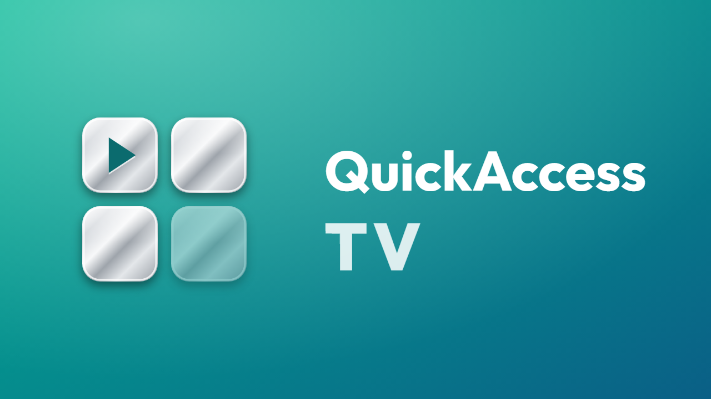
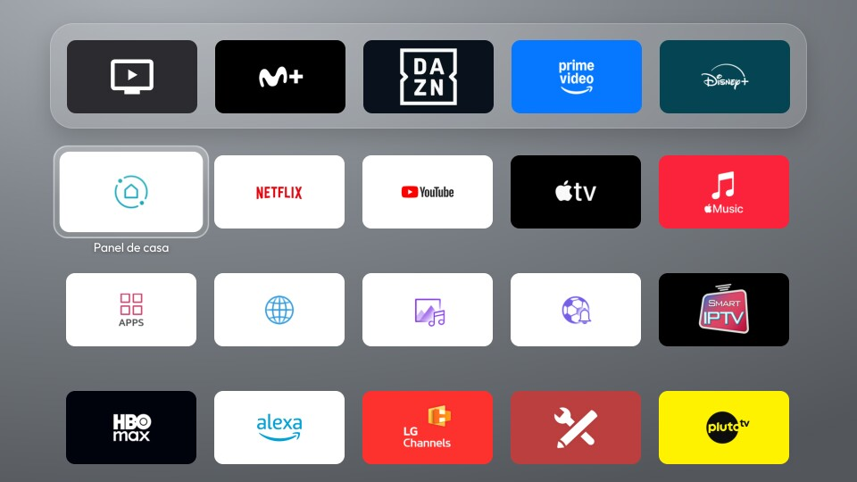
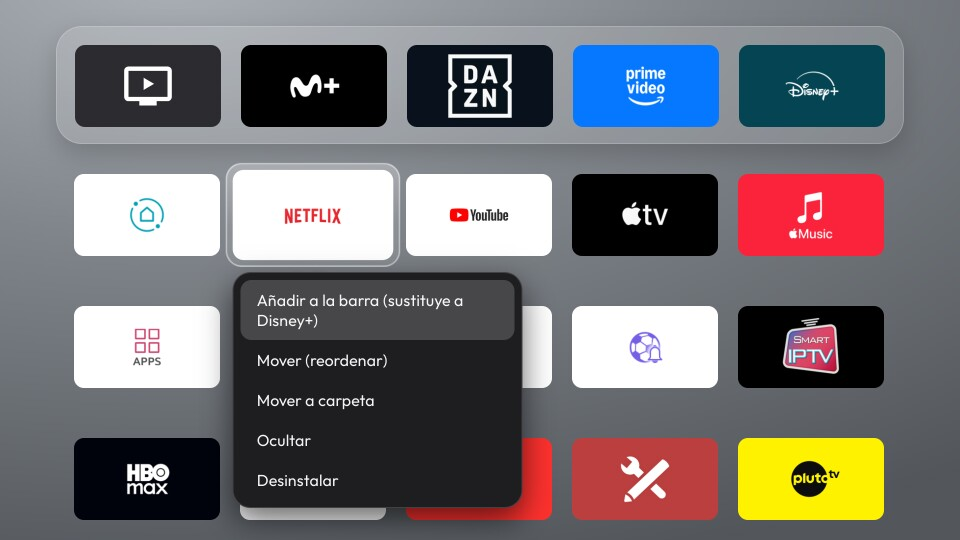
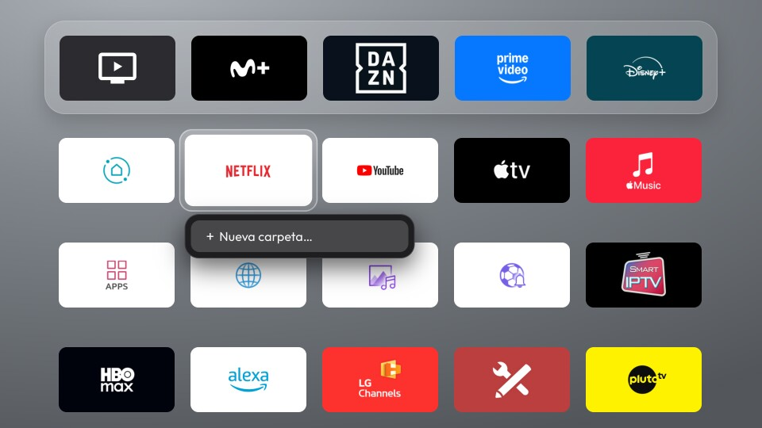
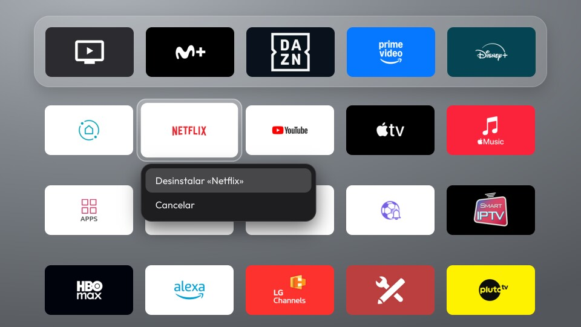

<p align="center"></p>

# QuickAccess TV

Pantalla de inicio para la tele, al estilo Apple TV: un dock con tus apps favoritas, la rejilla con todas
las demás, carpetas y fondos 4K. Una sola interfaz web que funciona en **LG webOS**, **Android TV** y
**Fire TV**.

| LG webOS | Android TV | Fire TV |
|---|---|---|
|  |  |  |

## Qué hace

- **Dock** con tus apps favoritas y **rejilla** con todas las instaladas, con sus banners e iconos.
- **Carpetas**, reordenar apps y carpetas con el mando, renombrar con teclado en pantalla, ocultar apps.
- **Fondos 4K** que rotan con el dock en reposo y se difuminan al entrar en la rejilla.
- Reloj, estado de la red y acceso directo a los ajustes de la tele.
- Todo se maneja con las flechas y OK del mando; mantener OK abre el menú de cada app.
- **HomeWatchdogService** (opcional): en Fire TV y LG, donde el sistema no deja cambiar la pantalla de
  inicio sin root, vuelve a abrir QuickAccess TV al pulsar Inicio. Técnica original de este proyecto,
  explicada en [docs/home-watchdog.md](docs/home-watchdog.md).

| Rejilla de apps | Menú de una app (mantener OK) |
|---|---|
|  |  |
| **Crear una carpeta** (Mover a carpeta → Nueva carpeta) | **Desinstalar**, con confirmación |
|  |  |

Capturas tomadas en LG webOS; la interfaz es la misma en Android TV y Fire TV.

## Instalación

Todos los comandos se ejecutan en el PC, desde la carpeta raíz del repositorio, con **bash** (en Windows,
Git Bash). Sustituye `<ip-de-la-tele>` por la IP de tu tele. La guía de cada plataforma explica los
requisitos con más detalle.

### LG webOS

Se instala como app del Modo Desarrollador de LG. Necesitas **Node.js**, y en la tele la app
**Developer Mode** con **Dev Mode Status** y **Key Server** activados (cuenta gratuita de LG Developer).
Guía completa: [lg-webos/README.md](lg-webos/README.md).

```sh
cd lg-webos
npm install                                   # herramientas ares de LG (solo la primera vez)
npx ares-setup-device                         # añade el dispositivo "lgtv": <ip-de-la-tele>, puerto 9922, usuario prisoner
npx ares-novacom --device lgtv --getkey       # escribe la frase que muestra Developer Mode en la tele
./build-and-install.sh                        # empaqueta, instala y abre QuickAccess TV
WATCHDOG=1 ./build-and-install.sh             # opcional: también HomeWatchdogService (la casita abre la app)
```

Desinstalar: `./uninstall.sh` (desde `lg-webos/`).

### Android TV

Se instala por ADB y queda como pantalla de inicio: el botón Inicio del mando la abre. Necesitas
**JDK 17** y **Android SDK**, y en la tele la **depuración por red** activada.
Guía completa: [android-tv/README.md](android-tv/README.md).

```sh
adb connect <ip-de-la-tele>:5555                          # acepta el aviso que aparece en la tele
TV=<ip-de-la-tele>:5555 ./android/build-and-install.sh    # compila, instala, la fija como Home y la abre
```

Desinstalar: `adb -s <ip-de-la-tele>:5555 uninstall com.quickaccesstv.app`

### Fire TV

Fire OS no deja cambiar la pantalla de inicio, así que se instala como app normal. Con
HomeWatchdogService (opcional) vuelve sola al pulsar Inicio; mantener Inicio pulsado deja el Home de
Amazon. Necesitas **JDK 17** y **Android SDK**, y en el Fire TV la **depuración ADB** activada.
Guía completa: [fire-tv/README.md](fire-tv/README.md).

```sh
adb connect <ip-de-la-tele>:5555                                        # acepta el aviso que aparece en la tele
TV=<ip-de-la-tele>:5555 FLAVOR=firetv ./android/build-and-install.sh              # solo la app
TV=<ip-de-la-tele>:5555 FLAVOR=firetv WATCHDOG=1 ./android/build-and-install.sh   # opcional: con HomeWatchdogService
```

Después, en el Fire TV: Apps → **Mis apps y juegos** → QuickAccess TV → ☰ → **Mover**, para subirla a
favoritos.

Desinstalar: `adb -s <ip-de-la-tele>:5555 uninstall com.quickaccesstv.app.firetv`

## Estructura

```
web/          interfaz común (HTML/CSS/JS): dock, rejilla, carpetas, foco con el mando
android/      proyecto Android (WebView) con dos variantes: androidtv y firetv
lg-webos/     empaquetado webOS, herramientas del Modo Desarrollador y guía de la LG
android-tv/   guía de Android TV y limpieza opcional del sistema (debloat/)
fire-tv/      guía de Fire TV
docs/         HomeWatchdogService: la técnica sin root para Fire TV y LG, con lo descubierto de cada sistema
tools/        utilidades del repositorio (vista previa HTML de la documentación)
design/icon/  icono y banner en SVG, y el script que genera los PNG de cada plataforma
```

`web/js/home.js` no habla nunca con el sistema: usa `window.PLATFORM`, que rellena una capa por
plataforma (`platform-webos.js` con las APIs de LG, `platform-android.js` con el puente nativo del WebView).

## Configuración

`web/js/config.js` reúne lo que se puede ajustar sin tocar código: columnas del dock, apps ocultas,
fondos y cada cuántos minutos rotan. Tras cambiarlo, vuelve a instalar en la tele.

## Documentación en el navegador

Para revisar la documentación como páginas web navegables (cada `.md` genera su `.html`; el README de la
raíz, `index.html`):

```sh
npm install        # solo la primera vez
npm run docs       # vuelve a generar los .html tras cambiar algún .md
npm run docs:pdf   # une toda la documentación en QuickAccessTV.pdf (necesita Edge o Chrome)
```

## Icono

El icono y el banner salen de `design/icon/icon.js`. Para regenerar los PNG de todas las plataformas:

```sh
design/icon/render.sh      # necesita Node.js y Edge o Chrome
```

## Plataformas probadas

QuickAccess TV 3.0.0 se ha instalado y probado en:

| Plataforma | Sistema | Versión de Android / API | Aparato |
|---|---|---|---|
| LG webOS | webOS TV 7.6.0 (webOS 22) | — | Televisor LG con webOS 22 |
| Android TV | Android TV 14 | Android 14, API 34 | Decodificador Android TV |
| Fire TV | Fire OS 6.7.1.1 | Android 7.1.2, API 25 | Fire TV Stick 4K (1.ª generación) |

La app Android admite desde Android 6.0 (`minSdk 23`). En webOS usa las APIs SSAP y Luna del Modo
Desarrollador.

### Herramientas de compilación

| Herramienta | Versión |
|---|---|
| JDK | 17 |
| Gradle | 8.9 |
| Android Gradle Plugin | 8.5.2 |
| Android SDK | `compileSdk` / `targetSdk` 34, `minSdk` 23 |
| AndroidX WebKit | 1.11.0 |
| webOS TV CLI (`@webos-tools/cli`) | 3.2.6 |
| Node.js | 18 o superior |

## Versión

La versión se define en `web/js/version.js` y debe coincidir con `lg-webos/appinfo.json` y con
`versionName` de `android/app/build.gradle`. En la tele se ve en **Ajustes ⚙ → Novedades**.

## Créditos

Fondos 4K de [Unsplash](https://unsplash.com), servidos por [Lorem Picsum](https://picsum.photos),
bajo la [licencia de Unsplash](https://unsplash.com/license):

| Archivo | Autor | Original |
|---|---|---|
| `web/img/wallpapers/wp1.jpg` | Andrew Ridley | [unsplash.com/photos/Kt5hRENuotI](https://unsplash.com/photos/Kt5hRENuotI) |
| `web/img/wallpapers/wp2.jpg` | Philippe Wuyts | [unsplash.com/photos/_h7aBovKia4](https://unsplash.com/photos/_h7aBovKia4) |
| `web/img/wallpapers/wp3.jpg` | Andrew Coelho | [unsplash.com/photos/VB-w_3dnyvI](https://unsplash.com/photos/VB-w_3dnyvI) |
| `web/img/wallpapers/wp4.jpg` | Go Wild | [unsplash.com/photos/V0yAek6BgGk](https://unsplash.com/photos/V0yAek6BgGk) |

- Tipografía [Outfit](https://fonts.google.com/specimen/Outfit), de Rodrigo Fuenzalida, bajo la
  [SIL Open Font License 1.1](https://openfontlicense.org).
- [html2canvas](https://html2canvas.hertzen.com) 1.4.1, de Niklas von Hertzen, bajo licencia MIT
  (solo para las capturas de depuración en webOS).

## Licencia

[MIT](LICENSE).
