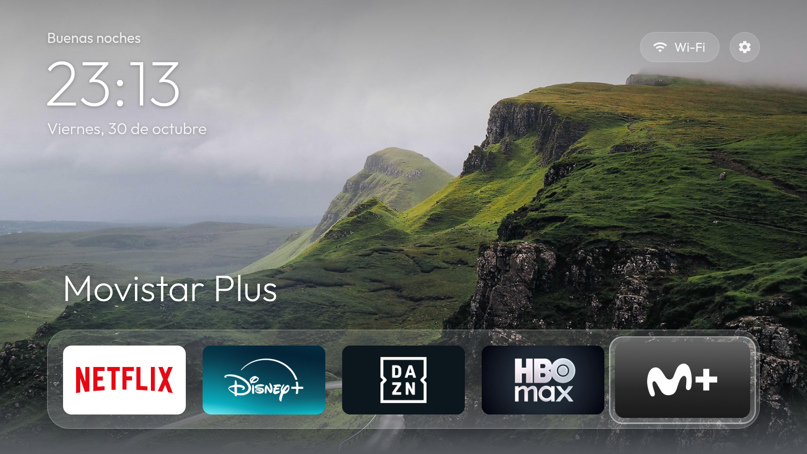

# QuickAccess TV en Android TV



En Android TV, QuickAccess TV sustituye a la pantalla de inicio: el botón Inicio del mando la abre
directamente. Id de la app: `com.quickaccesstv.app`.

**Probado en:** Android TV 14 (API 34). Admite desde Android 6.0 (API 23).

## Requisitos

- Android TV 6.0 o superior con **depuración por red** activada:
  Ajustes → Preferencias del dispositivo → Información → pulsa 7 veces **Compilación**, y después
  Opciones para desarrolladores → **Depuración por USB / por red**.
- PC con **JDK 17**, **Android SDK** (platform-tools y build-tools) y **bash** (en Windows, Git Bash).
  El script busca el JDK en `$JAVA_HOME17` y el SDK en `$ANDROID_HOME`; si no están definidos, los
  busca en `~/android-build/jdk` y `~/android-build/sdk`.

## Instalar

```sh
adb connect <ip-de-la-tele>:5555        # acepta el aviso que aparece en la tele
TV=<ip-de-la-tele>:5555 ./android/build-and-install.sh
```

El script copia la interfaz común en el APK, lo compila, lo instala, la fija como pantalla de inicio
(`cmd package set-home-activity`) y la abre. También concede el permiso de ubicación, que Android
exige para mostrar el nombre de la red Wi-Fi.

Si al pulsar Inicio aparece la pantalla original, elige **QuickAccess TV** cuando Android pregunte qué
app usar, o desactiva el launcher original con la limpieza opcional de abajo.

## Limpieza opcional del sistema (debloat)

`debloat/` desactiva apps del sistema que no hacen falta: telemetría, recomendaciones con publicidad y
el launcher original. Se desactivan con `pm disable-user`, nunca se desinstalan, así que todo se puede
deshacer.

```sh
cd android-tv/debloat
TV=<ip-de-la-tele>:5555 tools/disable.sh com.google.android.tvlauncher   # desactiva y lo anota en disabled.list
TV=<ip-de-la-tele>:5555 ./restore.sh                                      # vuelve a activar todo lo de disabled.list
```

`disabled.list` incluye una lista de ejemplo, con telemetría y recomendaciones de Google y apps
preinstaladas. Revísala antes de aplicarla, porque depende de cada aparato. `tools/disable.sh` se niega
a desactivar paquetes del núcleo del sistema.

Otras herramientas:

- `tools/tv.sh '<comando>'`: ejecuta un comando en la tele.
- `tools/shot.sh <archivo.png> [TECLAS]`: pulsa teclas del mando y guarda una captura.
- `tools/adb-closed.sh <ip>`: comprueba que la depuración por red ha quedado cerrada.

## Desinstalar

```sh
TV=<ip-de-la-tele>:5555 android-tv/debloat/restore.sh   # si usaste la limpieza: recupera el launcher original
adb -s <ip-de-la-tele>:5555 uninstall com.quickaccesstv.app
```
