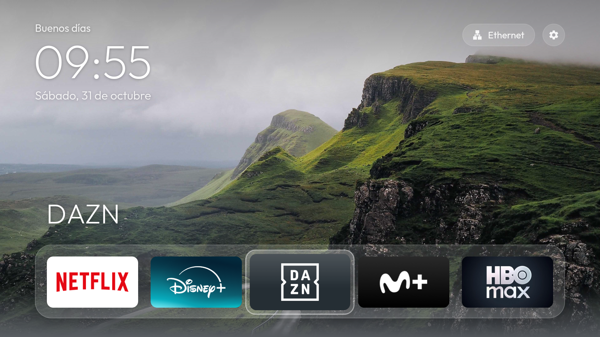

# QuickAccess TV en Fire TV



Fire OS no permite que una app sustituya a su pantalla de inicio: el botón Inicio siempre abre el Home
de Amazon. Por eso, en Fire TV QuickAccess TV es una app normal y, de forma **opcional**, se instala con
**HomeWatchdogService**, un servicio que la vuelve a abrir en cuanto aparece el Home de Amazon, sin root.
Cómo funciona y qué se descubrió de Fire OS por el camino: [docs/home-watchdog.md](../docs/home-watchdog.md).
Id de la app: `com.quickaccesstv.app.firetv`.

**Probado en:** Fire TV Stick 4K (1.ª generación) con Fire OS 6.7.1.1 (Android 7.1.2, API 25).

## Cómo se comporta con HomeWatchdogService

| Acción | Resultado |
|---|---|
| Pulsar **Inicio** | Vuelve a QuickAccess TV. Mientras Fire OS tarda en devolverla (unos segundos), se muestra su última imagen, de modo que el Home de Amazon casi no se ve. Durante 5 s, un aviso recuerda «Mantén pulsado Inicio para ir al Home de Amazon». |
| **Mantener pulsado Inicio** | Se abre el menú rápido de Fire TV y la vuelta automática queda en **pausa**: puedes usar el Home de Amazon con normalidad. |
| Abrir QuickAccess TV a mano | Se reactiva la vuelta automática. |
| Encender o reiniciar el Fire TV | QuickAccess TV se abre sola y la vuelta automática se reactiva. |
| Botón **Ajustes ⚙** | Abre la Configuración de Fire TV a pantalla completa, sin que la app la tape. |

Sin el servicio, QuickAccess TV es una app más: se abre desde la biblioteca o los favoritos y el botón
Inicio lleva al Home de Amazon.

Además, la rejilla oculta las apps de sistema de Amazon salvo Prime Video. La lista de excepciones es
`FIRE_KEEP_SYSTEM` en `web/js/platform-android.js`.

## Requisitos

- Fire TV con **depuración ADB** activada: Ajustes → Mi Fire TV → Acerca de → pulsa 7 veces el nombre
  del dispositivo, y después Mi Fire TV → Opciones para desarrolladores → **Depuración ADB**.
- PC con **JDK 17**, **Android SDK** y **bash**, como en [Android TV](../android-tv/README.md#requisitos).

## Instalar

```sh
adb connect <ip-del-fire-tv>:5555        # acepta el aviso que aparece en la tele

# Solo la app
TV=<ip-del-fire-tv>:5555 FLAVOR=firetv ./android/build-and-install.sh

# La app con HomeWatchdogService (vuelve sola al pulsar Inicio)
TV=<ip-del-fire-tv>:5555 FLAVOR=firetv WATCHDOG=1 ./android/build-and-install.sh
```

Sin `WATCHDOG=1` el servicio no se instala: el APK no lleva ni el servicio, ni el arranque al encender,
ni los permisos especiales. Con `WATCHDOG=1`, el script además concede por ADB los dos permisos que
necesita la vuelta automática:

```sh
adb shell appops set com.quickaccesstv.app.firetv android:get_usage_stats allow   # detectar el Home de Amazon
adb shell appops set com.quickaccesstv.app.firetv SYSTEM_ALERT_WINDOW allow       # tapar la espera al volver
```

Fire OS no tiene pantalla para conceder estos permisos; si reinstalas la app desde otro sitio, vuelve a
ejecutar esas dos líneas.

Al terminar, el script abre la app una vez y **reinicia el Fire TV** (`NO_REBOOT=1` para evitarlo):

- El launcher de Amazon solo vuelve a leer el icono de las apps instaladas fuera de la Appstore al
  arrancar; sin reiniciar, el tile de QuickAccess TV sale en blanco tras instalar o actualizar. Si se
  actualiza sin reiniciar (por ejemplo, con Downloader), la propia app avisa al abrirse y ofrece ir a
  Ajustes → Mi Fire TV → Reiniciar.
- Android deja una app recién instalada "detenida" y no le entrega el aviso de arranque hasta que se abre
  una vez: por eso el script la abre antes de reiniciar.

Tras encender, QuickAccess TV aparece en cuanto Fire OS entrega el aviso de arranque a las apps de
terceros, unos segundos después de mostrar su propio Home.

Para tenerla en la fila superior: Apps → **Mis apps y juegos**, selecciona **QuickAccess TV**, pulsa ☰ →
**Mover** y súbela a favoritos.

## Desinstalar

```sh
adb -s <ip-del-fire-tv>:5555 uninstall com.quickaccesstv.app.firetv
```

O desde el Fire TV: Ajustes → Aplicaciones → Administrar aplicaciones instaladas → QuickAccess TV →
Desinstalar.
