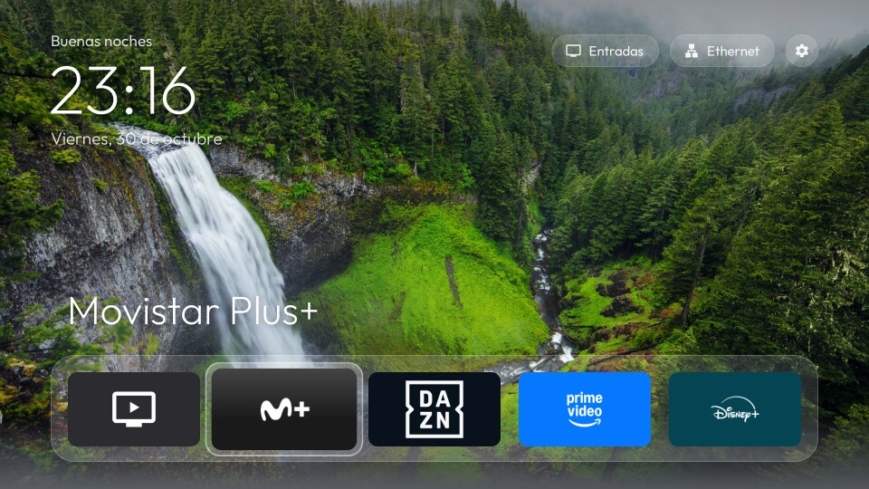

# QuickAccess TV en LG webOS



En LG se instala como app del **Modo Desarrollador**. No hace falta root y no se modifica nada del
sistema. Id de la app: `com.quickaccesstv.app`.

**Probado en:** webOS TV 7.6.0 (webOS 22), con `@webos-tools/cli` 3.2.6.

## Requisitos

- Tele LG con webOS y la app **Developer Mode** de la LG Content Store (necesita una cuenta gratuita de
  [LG Developer](https://webostv.developer.lge.com)).
- PC en la misma red que la tele, con **Node.js** y **bash** (en Windows sirve Git Bash).

## 1. Activar el Modo Desarrollador en la tele

1. Instala **Developer Mode** desde la LG Content Store y ábrela.
2. Inicia sesión con tu cuenta de LG Developer y activa **Dev Mode Status**. La tele se reinicia.
3. Vuelve a abrir Developer Mode y activa **Key Server**. Anota la IP que muestra.

## 2. Preparar el PC

```sh
cd lg-webos
npm install                                   # herramientas ares de LG, solo la primera vez
npx ares-setup-device                         # añade un dispositivo llamado "lgtv":
                                              #   IP de la tele, puerto 9922, usuario prisoner
npx ares-novacom --device lgtv --getkey       # pide la frase que aparece en Developer Mode
```

## 3. Instalar

```sh
./build-and-install.sh                # solo la app
WATCHDOG=1 ./build-and-install.sh     # la app con HomeWatchdogService (opcional, ver abajo)
```

Monta la interfaz común (`../web`) junto con la capa webOS, crea el `.ipk`, lo instala y abre la app.
La primera vez, la tele pide permiso para que la app vea la lista de aplicaciones: acéptalo.

Para tenerla a mano, colócala la primera de la barra de LG: pulsa la casita, mantén OK sobre
**QuickAccess TV** y muévela al principio.

## Mantener la sesión del Modo Desarrollador

LG desactiva el Modo Desarrollador cuando caduca la sesión (hasta 1000 h). Se puede renovar con el
botón **Extend** de la app Developer Mode o desde el PC:

```sh
# Una vez: guarda el token de la sesión (por SSH a la tele, con la clave de ares-novacom)
LG_HOST=<ip-de-la-tele> LG_ASKPASS=<script-que-imprime-la-frase> \
  tools/lgsh.sh 'cat /var/luna/preferences/devmode_enabled' | tr -d '\r\n ' > tools/.devmode-token

tools/extend-devmode.sh           # renueva a 1000 h
tools/extend-devmode.sh --check   # muestra el tiempo restante
```

En Windows también existe `tools\extend-devmode.ps1`. El token es personal: `.gitignore` lo excluye.

## HomeWatchdogService (opcional): la casita abre QuickAccess TV

webOS no permite cambiar lo que abre la casita del mando. Con `WATCHDOG=1` se instala junto a la app un
servicio JS que vigila por SSAP qué app está delante y, cuando aparece la barra de LG, vuelve a abrir
QuickAccess TV, sin root. Cómo funciona y qué se descubrió de webOS por el camino:
[docs/home-watchdog.md](../docs/home-watchdog.md).

| Acción | Resultado |
|---|---|
| Pulsar la casita | Vuelve a QuickAccess TV en unos 0,7 s; durante 5 s un aviso recuerda que otra pulsación lleva al menú de LG. |
| Pulsar la casita otra vez con la app ya de vuelta | Se queda la barra de LG, con un aviso de que la vuelta automática está en pausa. |
| Abrir QuickAccess TV a mano | Se reactiva. |
| Encender la tele | Se queda la app con la que arranca la tele (TV en directo o la última entrada); la vuelta automática se reactiva. |

El servicio se arranca la primera vez que se abre la app y después se mantiene solo, también tras
apagar y encender la tele. Para quitarlo, reinstala sin `WATCHDOG=1`.

## Lo que webOS no permite

- Sin el servicio, la casita del mando siempre abre la barra de LG; QuickAccess TV se abre desde ahí.
- No se pueden desactivar apps del sistema.

## Desinstalar

```sh
./uninstall.sh
```

Sin PC: en la barra de LG, mantén OK sobre **QuickAccess TV** y elige **Eliminar**.

## Desarrollo

- `node tools/capture.js <ip-de-la-tele> capturas/inicio.jpg` abre QuickAccess TV y guarda una captura
  real de la pantalla de la tele (Node 22 o superior). La primera vez la tele pide aceptar un
  emparejamiento; la clave queda en `tools/.ssap-client-key`, excluida del repo.
- `tools/receiver.py` recibe registros y capturas de la tele en `logs/`; actívalo con `debugReport`
  en `web/js/config.js`.
- `tools/shot.sh <nombre> [TECLAS]` abre la app, simula teclas del mando y guarda una captura de la
  página en `logs/` (necesita `receiver.py` en marcha y `debugReport` configurado). webOS no deja leer
  los iconos de las apps desde la página, así que en esa captura aparecen sus nombres en lugar de los
  iconos.
